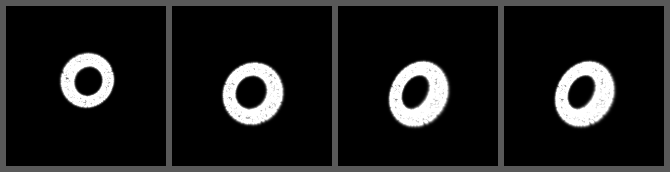

# twistor-render-core

Experimental differentiable 3D rendering engine built on **Roger Penrose's Twistor Theory** ($\mathbb{C}P^3$) and complex 2-spinors using **PyTorch & Intel XPU**.

Instead of traditional Euclidean $4 \times 4$ matrices and discrete rasterization pipelines, this engine evaluates null-geodesic geometry, $SU(2)$ spinor conjugation ($X_{\text{cam}} = R_A X R_A^\dagger$), and complex projective eigenspinor incidence relations ($\omega^A = i X^{AA'} \pi_{A'}$) via native `torch.complex64` 3D GEMM contractions.


*End-to-end differentiable 6-DoF camera pose recovery (3D position + SU(2) yaw/pitch rotation) optimizing directly through complex spinor incidence residuals on Intel XPU: `[Initial Guess | Epoch 45 | Final Recovered | Ground Truth]`.*

---

## Core Architecture (v0.4)

### 1. Native `complex64` Eigenspinor Incidence Kernel (`twistor/renderer.py`)
* **Projective Eigenspinor Testing:** Evaluates exact perpendicular incidence residuals ($\|\omega^A - i X^{AA'}\pi_{A'}\|^2 - |\langle \pi | \omega - i X \pi \rangle|^2$) in native `torch.complex64`, cutting intermediate tensor memory payloads in half compared to real FP32 block expansions.
* **Differentiable 6-DoF $SU(2)$ Spinor Rotations:** Applies unitary $SU(2)$ spinor conjugation ($R_A X R_A^\dagger$) alongside complex Hermitian translations ($C^{AA'}$), preserving full PyTorch autograd flow across all 6 degrees of freedom (`x, y, z, yaw, pitch`).
* **SYCL-Index-Safe 3D GEMM:** Replaces 4D broadcasting tensors with direct 3D matrix multiplications (`[P, 2, 2] @ [2, R]`), preventing SYCL 32-bit index overflow errors on Intel Level Zero backends.

### 2. Hermitian Bounding-Sphere Cluster Culling (`twistor/bvh.py`)
* **Spatial Acceleration:** Mitigates the $O(M \cdot N)$ brute-force ray-point bottleneck by sorting points along depth, grouping them into local Hermitian bounding spheres, and culling non-visible clusters via vectorized XPU masking before dense matrix contractions.
* **Memory-Safe Super-Batching:** Evaluates surviving clusters in cache-friendly super-batches (`2048`) to prevent VRAM thrashing and Level Zero driver resource exhaustion on Intel Arc hardware.

---

## Performance Telemetry (Intel XPU)

### Spatial Cluster Culling vs. Brute-Force Scaling
Measured at $64 \times 64$ resolution on Intel XPU hardware:

| Points ($N$) | Brute-Force (ms) | Clustered Culling (ms) | Speedup |
| :--- | :--- | :--- | :--- |
| **10,000** | 37.98 ms | Warmup path | Baseline |
| **50,000** | 1,236.89 ms | 50.24 ms | **24.62x** |
| **100,000** | 7,606.16 ms | 111.29 ms | **68.34x** |

---

## Quickstart & Demos

1. **Setup Environment:**
   ```powershell
   pip install torch torchvision

[](https://colab.research.google.com/github/isopidi-stack/twistor-render-core/blob/main/demos/twistor_colab_demo.ipynb)

## 🌌 Interactive Visual Sandboxes

Unlike traditional graphics pipelines that rely on flat Euclidean $4 \times 4$ matrices and static triangle meshes, `twistor-render-core` represents geometry natively through **Penrose Twistor Theory ($\mathbb{CP}^3$)**, **complex 2-spinor incidence relations**, and **end-to-end differentiable PyTorch tensors**.

Explore our real-time, hardware-accelerated sandboxes (CUDA / XPU / CPU) to experience how non-Euclidean physics and continuous spinor optimization work in practice:

### Prerequisites
Ensure you have the engine installed along with `matplotlib` for real-time interactive rendering:
```bash
pip install matplotlib

1. Real-Time Gravitational Lensing Sandbox (examples/interactive_lensing.py)
Simulates Schwarzschild-like spacetime curvature and null geodesic light deflection (producing Einstein rings and optical caustics) driven by complex spinor perturbations rather than post-processing screen-space shaders.

python examples/interactive_lensing.py

Interactive Controls & Behavior:
Move your mouse cursor anywhere across the window to drag the gravitational mass center in real time.
Watch background coordinate grids and optical caustics bend, multiply, and warp instantaneously via parallel complex64 tensor evaluation.
Why it matters: Because the entire ray-bundle projection is differentiable through PyTorch autograd, this architecture scales naturally to inverse astrophysics problems—such as reconstructing hidden lensing mass distributions directly from observed distortions.

2. Topological Shape Morphing (examples/topological_morphing.py)
Demonstrates continuous, fluid 3D shape transitions (morphing seamlessly between a toroidal manifold and a harmonic spherical distribution) governed by complex eigenspinor incidence blending rather than rigid triangle-mesh re-rigging.

python examples/topological_morphing.py

Interactive Controls & Behavior:
Runs a continuous, real-time differentiable flow loop showing smooth topological evolution without mesh tearing or discrete vertex correspondence constraints.
Click and drag inside the 3D viewport to orbit around the morphing manifold from any angle while it deforms.
Why it matters: Traditional rasterizers struggle with topological changes because hard polygon connectivity breaks during optimization. Evaluating surfaces through spinor incidence parameters creates smooth, continuous gradient paths across arbitrary shape spaces.
