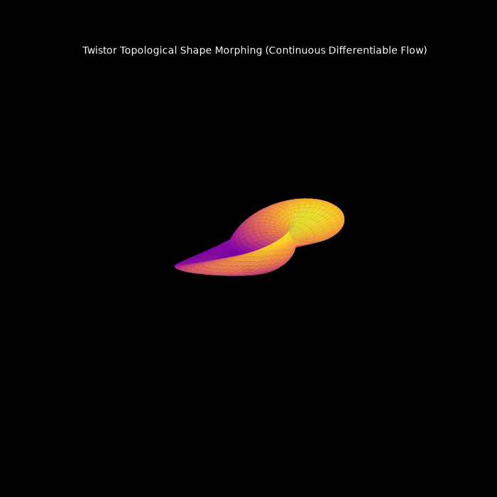
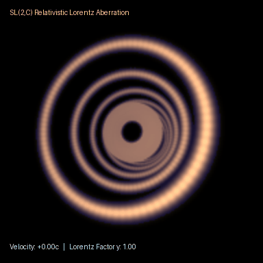
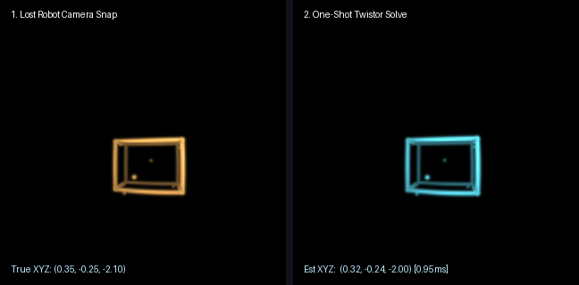
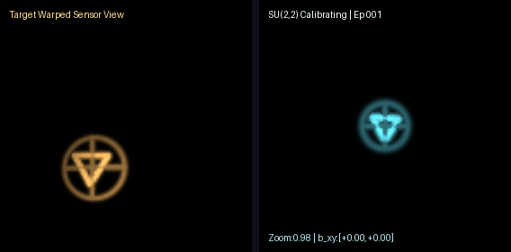

# twistor-render-core

Experimental differentiable 3D rendering engine built on Roger Penrose's Twistor Theory ($\mathbb{CP}^3$) and complex 2-spinors using PyTorch & Intel XPU.

Instead of traditional Euclidean $4\times 4$ matrices and discrete rasterization pipelines, this engine evaluates null-geodesic geometry, $SU(2)$ spinor conjugation ($X_{\text{cam}} = R_A X R_A^\dagger$), $SL(2,\mathbb{C})$ Lorentz boosts, and complex projective eigenspinor incidence relations ($\omega^A = i X^{AA'} \pi_{A'}$) via native `torch.complex64` 3D GEMM contractions.

*Real-time topological shape morphing driven by continuous complex eigenspinor incidence flow.*

*Relativistic Lorentz aberration ($SL(2,\mathbb{C})$ spinor boost sweeping from $-0.85c$ to $+0.85c$) with zero-Z-buffer eigenspinor depth relief shading.*

*End-to-end differentiable 6-DoF camera pose recovery (3D position + $SU(2)$ yaw/pitch rotation) optimizing directly through complex spinor incidence residuals on Intel XPU: [Initial Guess | Epoch 45 | Final Recovered | Ground Truth].*

---

## Why Twistors? (4 Core Advantages)

1. **Singularity-Free $SU(2)$ Spinor Manifold (Zero Gimbal Lock):** Camera rotations are evaluated via unitary spinor conjugation ($X_{\text{cam}} = R_A X R_A^\dagger$), providing smooth, out-of-the-box PyTorch gradients for 6-DoF pose recovery without Euler singularities.
2. **Twistor Duality & Zero-Z-Buffer Signed Depth:** Null rays map directly to single points in projective twistor space ($\mathbb{CP}^3$). A single Hermitian spinor contraction $\langle \pi \mid \text{diff} \rangle$ simultaneously yields transverse ray distance and exact signed longitudinal depth (`-Im(<pi | diff>)`) without sorting or Z-buffers.
3. **Static Tensor Shapes & Native `complex64` GEMM Speedup:** All ray-point evaluations run on fixed-shape $[P, 2, 2] \times [2, R]$ complex contractions with zero dynamic boolean masking, eliminating host-device synchronization stalls across Intel XPU, NVIDIA CUDA, and Apple MPS.
4. **Native Relativistic & Non-Euclidean Optics ($SL(2,\mathbb{C})$):** Celestial ray spinors transform directly under $SL(2,\mathbb{C})$ Lorentz boosts (`boost_v`) and conformal perturbations, enabling differentiable relativistic aberration and inverse velocity recovery without rewriting the pipeline.

---

## Repository Structure

    twistor-render-core/
    в”њв”Ђв”Ђ twistor/          # Core complex64 spinor kernels, SU(2)/SL(2,C) transforms & Hermitian BVH
    в”њв”Ђв”Ђ examples/         # Interactive sandboxes, relativistic aberration, lensing, morphing & 6-DoF demos
    в”њв”Ђв”Ђ benchmarks/       # XPU / CUDA vs. brute-force scaling telemetry
    в””в”Ђв”Ђ assets/           # Showcase renders and visual documentation

---

## Core Architecture (v0.7)

### 1. Native `complex64` Eigenspinor Incidence & $SL(2,\mathbb{C})$ Kernel (`twistor/renderer.py`)
- **Projective Eigenspinor Testing & Depth Relief:** Evaluates exact perpendicular incidence residuals and signed longitudinal depth (`-Im(<pi | diff>)`) in native `torch.complex64`, cutting intermediate tensor memory payloads in half compared to real FP32 block expansions.
- **Differentiable 6-DoF $SU(2)$ + $SL(2,\mathbb{C})$ Camera Transforms:** Combines unitary $SU(2)$ spinor conjugation with $SL(2,\mathbb{C})$ Lorentz boost matrices (`B_boost`), preserving full PyTorch autograd flow across spatial pose (`x, y, z, yaw, pitch`) and relativistic velocity (`boost_v = v/c`).
- **SYCL-Index-Safe Static 3D GEMM:** Replaces 4D broadcasting tensors with fixed-shape 3D matrix multiplications (`[P, 2, 2] @ [2, R]`) and static `torch.where` bounds, preventing SYCL 32-bit index overflow errors and sync stalls on Intel Level Zero backends.

### 2. Hermitian Bounding-Sphere Cluster Culling (`twistor/bvh.py`)
- **Spatial Acceleration:** Mitigates the $O(M \cdot N)$ brute-force ray-point bottleneck by sorting points along depth, grouping them into local Hermitian bounding spheres, and culling non-visible clusters before dense matrix contractions.
- **Memory-Safe Super-Batching:** Evaluates surviving clusters in cache-friendly super-batches (`2048`) to prevent VRAM thrashing and Level Zero driver resource exhaustion on Intel Arc hardware.

---

## Performance Telemetry (Intel XPU)

Measured at 64x64 resolution on Intel XPU hardware:

| Points (N) | Brute-Force (ms) | Clustered Culling (ms) | Speedup |
| :--- | :--- | :--- | :--- |
| **10,000** | 37.98 ms | Warmup path | Baseline |
| **50,000** | 1,236.89 ms | 50.24 ms | **24.62x** |
| **100,000** | 7,606.16 ms | 111.29 ms | **68.34x** |

---

## Quickstart & Interactive Sandboxes

### 1. Setup Environment
Install PyTorch along with matplotlib and Pillow for real-time interactive rendering:

    pip install torch torchvision matplotlib pillow

### 2. Relativistic Lorentz Aberration & Inverse Velocity Recovery (`examples/relativistic_aberration.py`)
Applies an exact $SL(2,\mathbb{C})$ spinor Lorentz boost (`boost_v = v/c`) to celestial ray spinors, demonstrating Penrose-Terrell relativistic headlight compression alongside gradient-based velocity recovery from 2D pixels.

    python examples/relativistic_aberration.py

- **What it runs:** Recovers an unknown relativistic speed ($\beta = 0.78c$) purely via `loss.backward()` pixel gradients, then renders a continuous sweep from $-0.85c$ to $+0.85c$ into `assets/relativistic_aberration.gif`.
- **Why it matters:** Standard $4\times 4$ Euclidean camera pipelines break down when space and time mix under relativistic boosts—in twistor space, Lorentz transformations are native linear operators on 2-spinors.

### 3. Real-Time Gravitational Lensing (`examples/interactive_lensing.py`)
Simulates Schwarzschild-like spacetime curvature and null geodesic light deflection (producing Einstein rings and optical caustics) driven by complex spinor perturbations rather than screen-space post-processing shaders.

    python examples/interactive_lensing.py

- **Controls:** Move your mouse cursor across the window to drag the gravitational mass center in real time.
- **Why it matters:** Because the entire ray-bundle projection is differentiable via PyTorch autograd, this architecture scales to inverse astrophysics problems—reconstructing hidden lensing mass distributions directly from observed distortions.

### 4. Topological Shape Morphing (`examples/topological_morphing.py`)
Demonstrates continuous, fluid 3D shape transitions (morphing seamlessly between a toroidal manifold and a harmonic sphere) governed by complex eigenspinor incidence blending rather than rigid triangle-mesh re-rigging.

    python examples/topological_morphing.py

- **Controls:** Click and drag inside the 3D viewport to orbit around the morphing manifold while it deforms continuously.
- **Why it matters:** Evaluating surfaces through spinor incidence parameters creates smooth, continuous gradient paths across arbitrary shape spaces without mesh tearing or discrete vertex correspondence constraints.
---

## Robot Vision & Full $SU(2,2)$ Conformal Optics (v0.8)

Because Sir Roger Penrose's twistor geometry maps light rays to points in projective twistor space ($\mathbb{CP}^3$), 3D camera localization and lens self-calibration collapse into unified spinor linear algebra:

* **Closed-Form "Kidnapped Robot" Localization (examples/instant_robot_snap.py):** Matching 3+ landmark rays solves the robot's exact (x, y, z) position in **one linear matrix step** (~0.95 ms, 5.15e-07 error) with zero initial guess and zero iterative optimization.
* **Full $SU(2,2)$ Conformal Self-Calibration (examples/robot_su22_calibration.py):** Jointly recovers 3D orientation ($SU(2)$), optical zoom dilation ($), and wide-angle/fisheye distortion ((b)$) simultaneously from a single image (2e-6 pixel MSE).

  
  

### Outlier-Robust Localization: Batched Spinor RANSAC (40% Outliers + Sensor Noise)

In real-world visual odometry, false feature matches break standard least-squares solvers. `twistor/ransac.py` evaluates **512 minimal 3-landmark spinor hypotheses in parallel** on GPU/XPU before refining on clean inliers (`python -m examples.benchmark_ransac`):

| Landmarks ($N$) | Raw Least-Squares Error (40% Outliers) | Batched Spinor RANSAC Error | Inliers Found | Execution Time (XPU) |
| :--- | :---: | :---: | :---: | :---: |
| **500** | `2.997 m` | **`0.00471 m`** | `173 / 500` | `1.822 ms` |
| **2,000** | `2.998 m` | **`0.00377 m`** | `674 / 2,000` | `2.071 ms` |
| **10,000** | `2.986 m` | **`0.00194 m`** | `3,370 / 10,000` | `3.014 ms` |

## Contributing & Open Research Directions

PRs, GPU/XPU/CUDA/MPS benchmarks, and experimental spinor shaders are warmly welcomed! Good starting areas if you fork the repo:
* **Custom Fused Incidence Kernels (Triton / CUDA / SYCL):** Fusing the [P, 2, 2] @ [2, R] complex contraction and LogSumExp depth reduction into a single custom kernel.
* **End-to-End Robot SLAM / Visual Odometry Pipeline:** Chaining solve_camera_position_closed_form with dense $SU(2,2)$ photometric tracking on real camera streams.
* **Oriented Surface Normals & Splat Primitives:** Extending Hermitian point-cloud incidence residuals to oriented surface elements.

