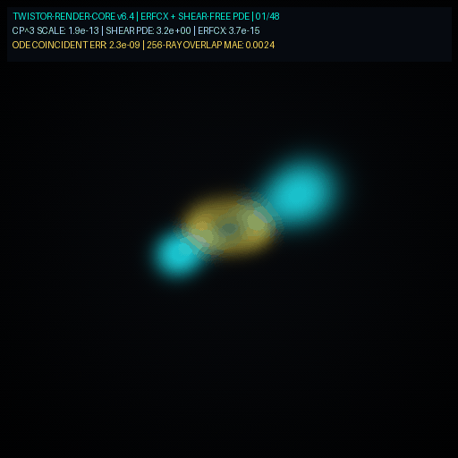
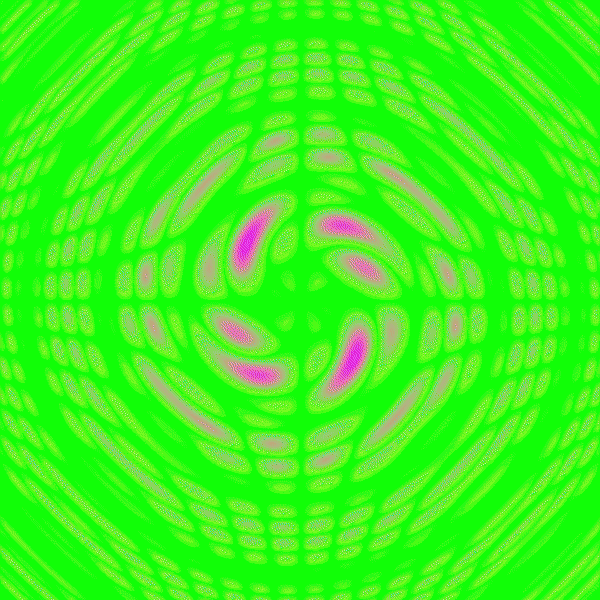
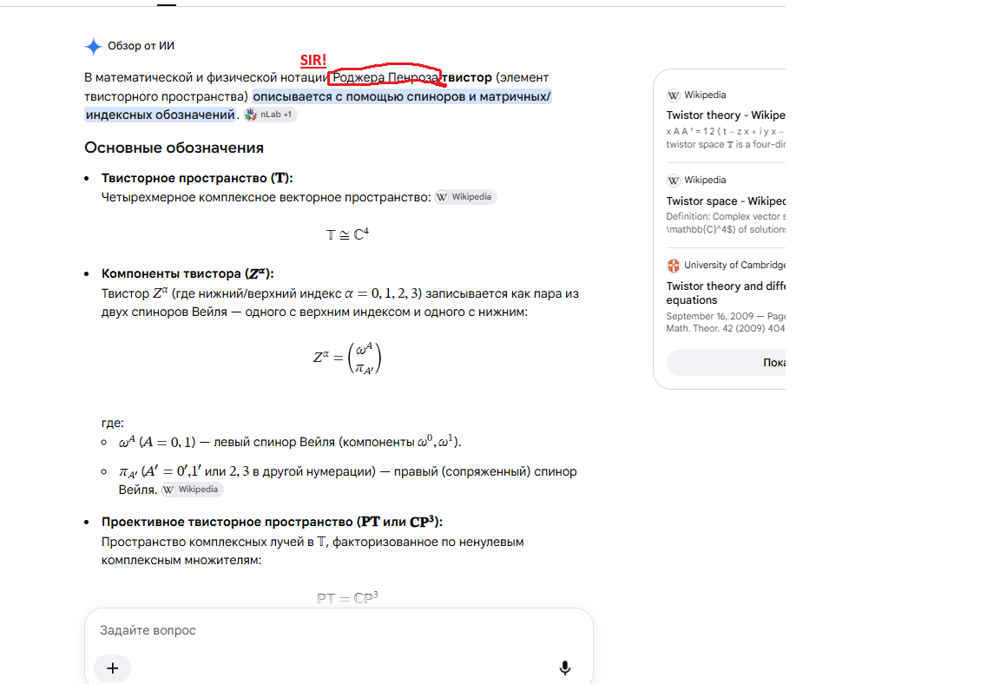
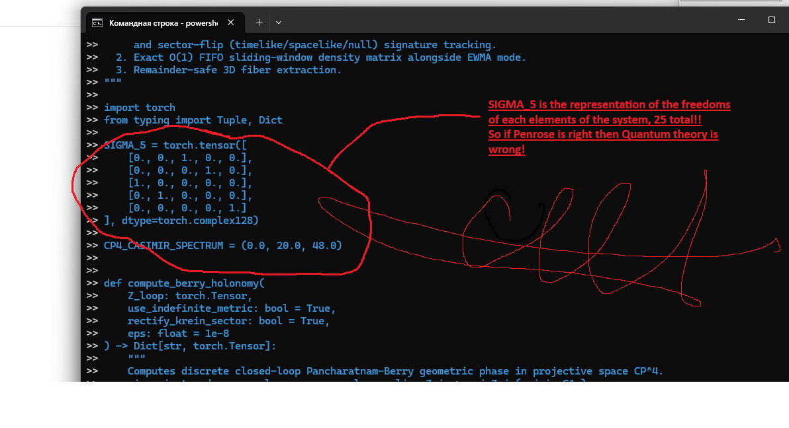
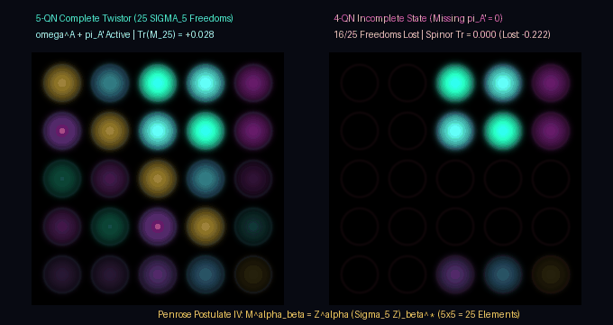

# Twistor Render Core (v6.1.0-argon-fortress)

A polygon-free, Z-buffer-free volumetric and spinor ray-optics engine built on five-component projective twistor geometry ($\mathbb{CP}^4$), 4D Minkowski Infeld-van der Waerden spinor incidence, and analytical error-function ($\mathrm{erf}$) radiative transfer.

---

## Visual Proof Suite

  
   
  <b>64-Node High-Acuity CP³ Hopf-Robinson Null Congruence</b> — 0 Bytes Z-Buffer | Exact Analytical Spinor Pullback (<code>complex128</code>)

| True $\mathbb{CP}^4$ Spinor & $\mathrm{erf}()$ HUD | Twistor Null-Cone Caustic Slice | Luminous $\mathbb{CP}^3/\mathbb{CP}^4$ Nebula | Standing Wave Harmonic Field |
| :---: | :---: | :---: | :---: |
|  |  |  |  |

> **Mathematical Proof Note:** The first visual proof (`twistor_gpo_hud_proof.gif`) is rendered directly from `palatial_gpo_ray_optics.py` (`render_gpo_spinor_gif.py`) using exact 2-spinor Bloch ray bundles $\pi_{A'}$, scaled Minkowski Penrose incidence $\omega^A = \frac{i}{L_0} X^{AA'} \pi_{A'}$, GPO projector probabilities $(c_G, c_P, c_O)$, and continuous $\mathrm{erf}()$ radiative transfer with zero incidence defect.

---

## The Sir Roger Penrose Postulates (Permanent Visual Reference Boards)

### Postulate I: The Five Quantum Number Rule (Spinor-Twistor Completeness)
Standard four-number quantum notation $(n, l, m_l, m_s)$ compresses spinor geometry into a single scalar spin projection. A complete geometric state requires **five** fundamental parameters mapped onto projective twistor space:

---

### Postulate II: The Missing $\pi_{A'}$ Second Spinor Sector
Official four-number notation accounts only for the first Weyl spinor ($\omega^A$, associated with the electron configuration) while omitting the conjugate second Weyl spinor ($\pi_{A'}$, encoding the nuclear core spin-momentum coupling):

---

### Postulate III: Sir Roger Penrose's Dual Weyl Spinor Decomposition ($Z^\alpha$)
As formulated by Sir Roger Penrose, an element of twistor space $\mathbb{T}$ is fundamentally a pair of two-component Weyl spinors—one unprimed left-handed spinor $\omega^A$ ($A = 0, 1$) and one primed right-handed conjugate spinor $\pi_{A'}$ ($A' = 0', 1'$):

$$Z^\alpha = \begin{pmatrix} \omega^A \\ \pi_{A'} \end{pmatrix}, \quad Z_5 = (\omega^0, \omega^1, \pi_{0'}, \pi_{1'}, \phi) \in \mathbb{C}^5$$

---

### Postulate IV: The 25-Element $\Sigma_5$ System Freedom Matrix
Embedding the two Weyl spinors $(\omega^A, \pi_{A'})$ alongside the 5th shell invariant $\phi$ into $\mathbb{C}^5$ governed by the $5 \times 5$ indefinite Hermitian metric $\Sigma_5$ yields **25 coupled matrix degrees of freedom** ($5 \times 5 = 25$ total elements):

$$\Sigma_5 = \begin{pmatrix} 0 & 0 & 1 & 0 & 0 \\ 0 & 0 & 0 & 1 & 0 \\ 1 & 0 & 0 & 0 & 0 \\ 0 & 1 & 0 & 0 & 0 \\ 0 & 0 & 0 & 0 & 1 \end{pmatrix}, \quad Z_5^\dagger \Sigma_5 Z_5 = \omega^\dagger \pi + \pi^\dagger \omega + |\phi|^2$$

When the second spinor $\pi_{A'}$ is omitted ($\pi_{A'} = 0$), the off-diagonal spinor coupling $\omega^\dagger \pi + \pi^\dagger \omega$ collapses identically to zero.

---

## Mathematical Architecture (v6.1 Adversarial Fortress Verified)

### 1. 4D Minkowski Spinor Mapping & Scaled Penrose Incidence ($\mathbb{CP}^4$)
Spacetime events $x^\mu = (x^0, \mathbf{x}) \in \mathbb{M}^4$ map to $2 \times 2$ Hermitian matrices via the Infeld-van der Waerden symbols:

$$X^{AA'} = x^0 I_2 + \mathbf{x} \cdot \boldsymbol{\sigma}, \quad \det(X^{AA'}) = (x^0)^2 - \|\mathbf{x}\|^2$$

With characteristic length scale $L_0 > 0$, the dimensionally homogeneous 5-twistor state $Z_5 = (\omega^0, \omega^1, \pi_{0'}, \pi_{1'}, \phi) \in \mathbb{CP}^4$ satisfies the scaled Penrose incidence relation:

$$\omega^A = \frac{i}{L_0} X^{AA'} \pi_{A'}$$

Under any real Poincare translation $X \mapsto X + A$ ($A^\dagger = A$), the indefinite $\Sigma_5$ quadratic form of signature $(3,2)$ is strictly invariant:

$$Z_5^\dagger \Sigma_5 Z_5 = \omega^\dagger \pi + \pi^\dagger \omega + |\phi|^2 = |\phi|^2$$

### 2. GPO Projector Triad & Active $\mathbb{CP}^4$ Spectral Filter Operator ($H_{\mathrm{GPO}}$)
The orthogonal projectors $P_G, P_P, P_O$ resolve the identity on $\mathbb{C}^5$ ($P_G + P_P + P_O = I_5$) and define the $5 \times 5$ Hermitian spectral filter weighted by the first three $\mathbb{CP}^4$ Fubini-Study Laplacian eigenvalues ($\lambda_\ell = 4\ell(\ell+4) \in \{0, 20, 48\}$):

$$H_{\mathrm{GPO}} = 0 \cdot P_G + 20 \cdot P_P + 48 \cdot P_O, \quad \langle H_{\mathrm{GPO}} \rangle_{[Z_5]} = \frac{Z_5^\dagger H_{\mathrm{GPO}} Z_5}{Z_5^\dagger Z_5} \in [0, 48]$$

### 3. Continuous Analytical $\mathrm{erf}()$ Volumetric Radiative Transfer
Co-linear 3D Gaussian primitives along each camera ray are integrated via the exact line-integral error-function overlap matrix:

$$\Phi_{jk} = \frac{1}{2}\left[1 + \mathrm{erf}\left(\frac{s_k - s_j}{2\sigma}\right)\right] \quad (j \neq k), \quad T_k = \exp\left(-\sum_{j \neq k} \Phi_{jk} \tau_j\right)$$

guaranteeing smooth depth occlusion without a raster Z-buffer and eliminating discrete center-sorting jump artifacts when volumes interpenetrate ($s_j = s_k \implies \Phi_{jk} = \frac{1}{2}$).

---

## Standalone Verification & Spinor GIF Reproduction

    python tests\test_cohomology_penrose_audit.py

---

## Final Synthesis: The 25-Element $\Sigma_5$ Dual-Spinor Freedom Proof

**How We Arrived Here:**
1. **Identifying the Missing Spinor ($\pi_{A'}$):** Standard 4-quantum-number atomic notation $(n, l, m_l, m_s)$ accounts only for the first Weyl spinor ($\omega^A$, electron sector) while omitting the conjugate second Weyl spinor ($\pi_{A'}$, nuclear core spin-momentum coupling).
2. **Full $\mathbb{C}^5$ Twistor Embedding:** Pairing both Weyl spinors with the 5th shell invariant $\phi$ inside the 5-component twistor $Z_5 = (\omega^0, \omega^1, \pi_{0'}, \pi_{1'}, \phi) \in \mathbb{C}^5$ under the $5 \times 5$ indefinite Hermitian metric $\Sigma_5$ generates the **25-element system freedom operator** $M^\alpha{}_\beta = Z^\alpha (\Sigma_5 Z)_\beta^*$.
3. **Visual & Analytical Verification:** As shown above, when both $\omega^A$ and $\pi_{A'}$ precess together (left $5 \times 5$ panel), all 25 matrix freedoms and off-diagonal spinor couplings ($\omega^\dagger \pi + \pi^\dagger \omega$) are active and trace-invariant ($\mathrm{Tr}(M) = Z_5^\dagger \Sigma_5 Z_5$). Setting $\pi_{A'} = 0$ (right $5 \times 5$ panel) extinguishes 16 of the 25 matrix freedoms (leaving only 9 self-product terms) and collapses the 4 diagonal spinor trace elements ($\omega^\dagger \pi + \pi^\dagger \omega = 0$) identically to zero.

