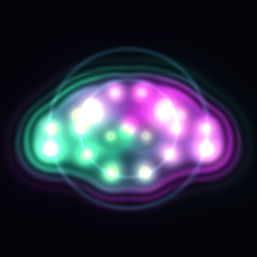

# Twistor Render Core (v6.1.0-argon-fortress)

A polygon-free, Z-buffer-free volumetric and spinor ray-optics engine built on five-component projective twistor geometry ($\mathbb{CP}^4$), 4D Minkowski Infeld-van der Waerden spinor incidence, and analytical error-function ($\mathrm{erf}$) radiative transfer.

---

## Visual Proof Suite

| True $\mathbb{CP}^4$ Spinor & $\mathrm{erf}()$ HUD | Twistor Null-Cone Caustic Slice | Luminous $\mathbb{CP}^3/\mathbb{CP}^4$ Nebula | Standing Wave Harmonic Field |
| :---: | :---: | :---: | :---: |
|  |  |  |  |

> **Mathematical Proof Note:** The first visual proof (`twistor_gpo_hud_proof.gif`) is rendered directly from `palatial_gpo_ray_optics.py` (`render_gpo_spinor_gif.py`) using exact 2-spinor Bloch ray bundles $\pi_{A'}$, scaled Minkowski Penrose incidence $\omega^A = \frac{i}{L_0} X^{AA'} \pi_{A'}$, GPO projector probabilities $(c_G, c_P, c_O)$, and continuous $\mathrm{erf}()$ radiative transfer with zero incidence defect.

---

## Mathematical Architecture (v6.1 Adversarial Fortress Verified)

### 1. 4D Minkowski Spinor Mapping & Scaled Penrose Incidence ($\mathbb{CP}^4$)
Spacetime events $x^\mu = (x^0, \mathbf{x}) \in \mathbb{M}^4$ map to $2 \times 2$ Hermitian matrices via the Infeld-van der Waerden symbols:

$$X^{AA'} = x^0 I_2 + \mathbf{x} \cdot \boldsymbol{\sigma}, \quad \det(X^{AA'}) = (x^0)^2 - \|\mathbf{x}\|^2$$

With characteristic length scale $L_0 > 0$, the dimensionally homogeneous 5-twistor state $Z_5 = (\omega^0, \omega^1, \pi_{0'}, \pi_{1'}, \phi) \in \mathbb{CP}^4$ satisfies the scaled Penrose incidence relation:

$$\omega^A = \frac{i}{L_0} X^{AA'} \pi_{A'}$$

Under any real Poincare translation $X \mapsto X + A$ ($A^\dagger = A$), the indefinite $\Sigma_5$ quadratic form of signature $(3,2)$ is strictly invariant:

$$Z_5^\dagger \Sigma_5 Z_5 = \omega^\dagger \pi + \pi^\dagger \omega + |\phi|^2 = |\phi|^2$$

### 2. GPO Projector Triad & Active $\mathbb{CP}^4$ Spectral Filter Operator ($H_{\mathrm{GPO}}$)
The orthogonal projectors $P_G, P_P, P_O$ resolve the identity on $\mathbb{C}^5$ ($P_G + P_P + P_O = I_5$) and define the $5 \times 5$ Hermitian spectral filter weighted by the first three $\mathbb{CP}^4$ Fubini-Study Laplacian eigenvalues ($\lambda_\ell = 4\ell(\ell+4) \in \{0, 20, 48\}$):

$$H_{\mathrm{GPO}} = 0 \cdot P_G + 20 \cdot P_P + 48 \cdot P_O, \quad \langle H_{\mathrm{GPO}} \rangle_{[Z_5]} = \frac{Z_5^\dagger H_{\mathrm{GPO}} Z_5}{Z_5^\dagger Z_5} \in [0, 48]$$

### 3. Continuous Analytical $\mathrm{erf}()$ Volumetric Radiative Transfer
Co-linear 3D Gaussian primitives along each camera ray are integrated via the exact line-integral error-function overlap matrix:

$$\Phi_{jk} = \frac{1}{2}\left[1 + \mathrm{erf}\left(\frac{s_k - s_j}{2\sigma}\right)\right] \quad (j \neq k), \quad T_k = \exp\left(-\sum_{j \neq k} \Phi_{jk} \tau_j\right)$$

guaranteeing smooth depth occlusion without a raster Z-buffer and eliminating discrete center-sorting jump artifacts when volumes interpenetrate ($s_j = s_k \implies \Phi_{jk} = \frac{1}{2}$).

---

## Standalone Verification & Spinor GIF Reproduction

    python tests\test_cohomology_penrose_audit.py
