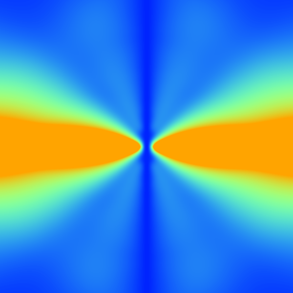
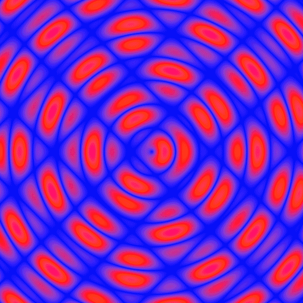

# Twistor Render Core (`v6.0.0-argon-cp4`)

A polygon-free, Z-buffer-free volumetric and spinor ray-optics engine built on five-component projective twistor geometry ($\mathbb{CP}^4$) and parallelized volumetric ray-marching.

---

## Visual Proof Suite

| Twistor Null-Cone Caustic Slice | Luminous $\mathbb{CP}^3/\mathbb{CP}^4$ Nebula | Standing Wave Harmonic Field |
| :---: | :---: | :---: |
|  |  |  |

---

## Mathematical Architecture (`v6.0` Argon Audit Verified)

### 1. Five-Component Projective State ($\mathbb{CP}^4$) & Indefinite Metric
States are represented as homogeneous 5-tuples modulo $\mathbb{C}^\times$ scaling:
$$Z_5 = (\omega^0, \omega^1, \pi_{0'}, \pi_{1'}, \phi) \in \mathbb{CP}^4$$
endowed with the indefinite Hermitian form $\Sigma_5$ of signature $(3,2)$:
$$\Sigma_5 = \begin{pmatrix} 0 & I_2 & 0 \\ I_2 & 0 & 0 \\ 0 & 0 & 1 \end{pmatrix}, \quad \operatorname{spec}(\Sigma_5) = \{1, 1, 1, -1, -1\}$$

### 2. Exact GPO Orthogonal Projector Partition & $\mathbb{CP}^4$ Spectrum
The Green, Purple, and Orange channels form a complete resolution of the identity on $\mathbb{C}^5$:
$$P_G + P_P + P_O = I_5, \quad c_G + c_P + c_O = 1 \quad (c_j = Z_5^\dagger P_j Z_5)$$
Under the standard Fubini–Study metric normalization (holomorphic sectional curvature $4$), the scalar Laplacian spectrum on $\mathbb{CP}^4$ follows:
$$\lambda_\ell = 4\ell(\ell + 4) \implies \{0, 20, 48\} \quad (\ell = 0, 1, 2)$$

### 3. Strict Penrose Incidence & Analytical Ray-Ordered Occlusion
* **Physical Incidence Separation:** `palatial_gpo_ray_optics.py` computes and preserves the exact physical incidence spinor $\omega^A = i X^{AA'} \pi_{A'}$ in `Z5_physical` (satisfying $\omega_{\mathrm{cam}} = 0$ at the spatial origin), keeping screen-space diagnostic HUD phase modulation strictly separate in `Z5_hud_diagnostic`.
* **Analytical Front-to-Back Transmittance:** Primitives along each camera ray are ordered by their longitudinal projection $s_k = \mathbf{d}_k \cdot \mathbf{n}$ and integrated via Beer–Lambert transmittance $T_k = \prod_{j < k} (1 - \alpha_j)$, achieving true depth occlusion without a raster Z-buffer grid.
