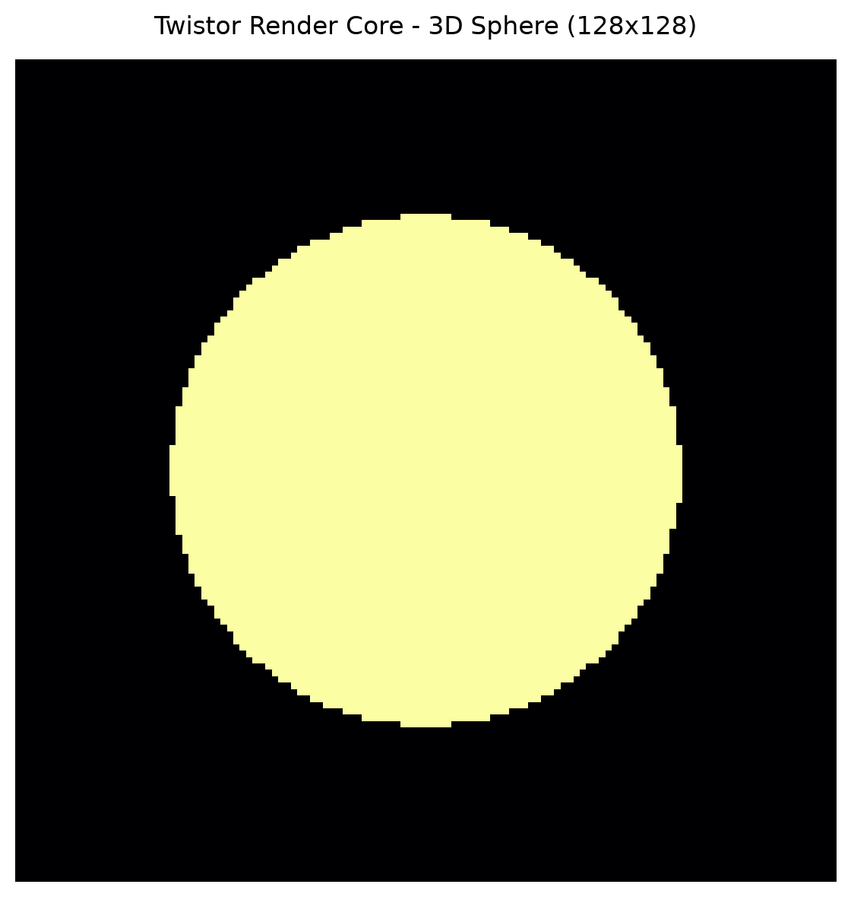

# Twistor Render Core

An open-source, experimental 3D rendering pipeline built on **Penrose's Twistor Theory** and **complex 2-spinors** using PyTorch.

Rather than relying on standard $4 \times 4$ real Euclidean transformation matrices and Bounding Volume Hierarchy (BVH) tree traversals, **Twistor Render Core** maps 3D spatial points into $2 \times 2$ complex Hermitian matrices $X^{AA'}$ and evaluates ray-point intersections via Penrose's incidence relation in complex projective space ($\mathbb{C}P^3$).

---

## 1. Mathematical Intuition

### Spacetime to Complex Hermitian Mapping
Points in Minkowski spacetime $x^a = (t, x, y, z)$ map to $2 \times 2$ complex Hermitian matrices $X^{AA'}$ via Pauli spin matrices:

$$X^{AA'} = \begin{pmatrix} t + z & x - iy \\ x + iy & t - z \end{pmatrix}$$

For 3D spatial coordinates $(x, y, z)$, light-cone radial distance $t = \sqrt{x^2 + y^2 + z^2}$ is evaluated so that spatial points satisfy null geodesic constraints along primary light paths originating from the camera center $(0,0,0)$.

### Penrose Incidence Relation
A light ray in twistor space is parameterized by a pair of 2-component complex spinors $Z^\alpha = (\omega^A, \pi_{A'})$. For primary rays passing through origin $X_0 = 0$, position spinor $\omega^A = 0$. A point $X^{AA'}$ lies on the null ray defined by momentum spinor $\pi_{A'}$ if and only if it satisfies Penrose's incidence relation:

$$\omega^A = i X^{AA'} \pi_{A'}$$

### Residual Collision Kernel & Volumetric Thresholding
In continuous space, a 1D null ray has zero measure for exact collision with a 0D point. Collision detection evaluates whether the complex norm residual falls within a geometric tolerance $\epsilon$:

$$\text{Residual} = \|\omega^A - i X^{AA'} \pi_{A'}\| < \epsilon$$

This residual tolerance acts as an implicit volumetric bounding radius around point cloud elements.

---

## 2. Engine Architecture

- `twistor/geometry.py`: Spatial-to-Hermitian conversions, complex spinor operations, and SL(2, C) Lorentz transformations.
- `twistor/incidence.py`: Vectorized Penrose incidence residual kernels and hit evaluation.
- `twistor/renderer.py`: Camera ray mapping into $\mathbb{C}P^3$ twistor space and 2D image buffer rasterization.
- `benchmarks/run_suite.py`: Automated performance and throughput benchmark suite.

---

## 3. Empirical CPU Benchmarks

Throughput measures single-ray-to-$N$-point batch incidence evaluations ($O(N)$ brute-force tensor contractions) across scaled point cloud sizes on a standard CPU backend using PyTorch SIMD vectorization:

| Point Count ($N$) | Execution Time (ms) | Throughput (Ray-Point Ops/sec) |
| :--- | :--- | :--- |
| **1,000** | 0.194 ms | 5,152,196 |
| **10,000** | 1.561 ms | 6,406,043 |
| **100,000** | 7.236 ms | 13,819,175 |
| **1,000,000** | 82.739 ms | 12,086,184 |

*Note: Current benchmarks measure unindexed $O(N)$ tensor operations. Future iterations will introduce twistor-space spatial tree partitioning.*

---

## 4. Quickstart

```bash
# Clone repository
git clone [https://github.com/isopidi-stack/twistor-render-core.git](https://github.com/isopidi-stack/twistor-render-core.git)
cd twistor-render-core

# Setup virtual environment
python -m venv venv
.\venv\Scripts\Activate.ps1

# Install dependencies
pip install torch matplotlib

# Run benchmark suite
python benchmarks/run_suite.py
---

## 5. Visual Render Output


*128x128 binary projection buffer of an 8,000-point 3D sphere evaluated using Penrose twistor incidence kernels.*
